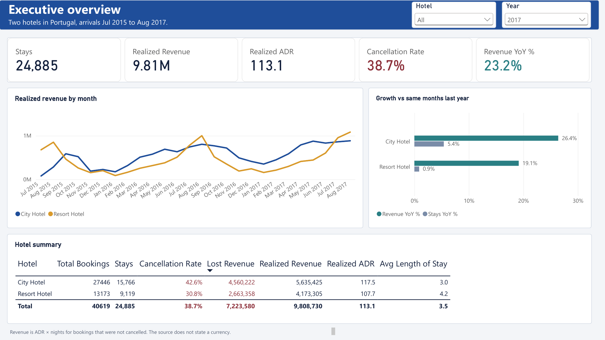
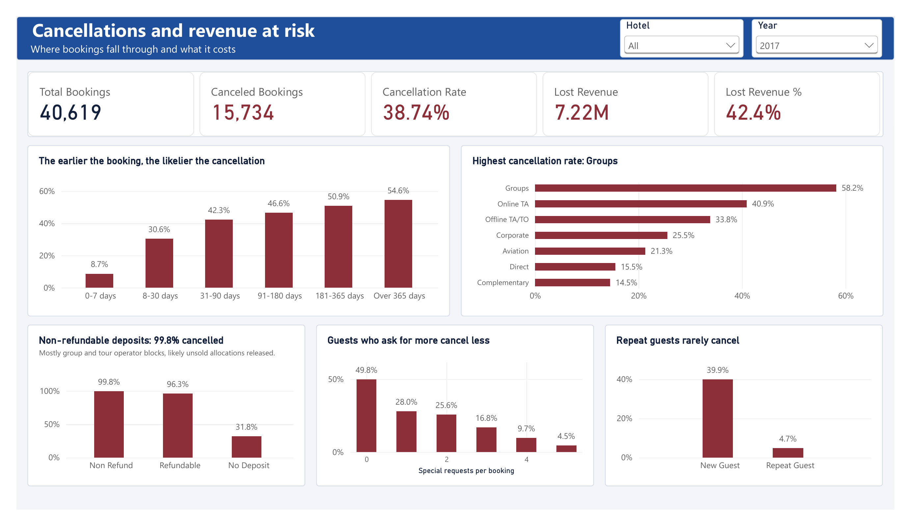

# Hotel Booking Demand Dashboard (Power BI)

A two-page Power BI report on 119,390 real bookings from two hotels in Portugal, a city hotel in Lisbon and a resort in the Algarve, with arrivals from July 2015 to August 2017. The report answers where growth came from and what cancellations cost.

## Key findings

Default view is 2017, compared like for like with the same months of 2016 (January to August).

- **Growth came from price, not volume.** Stays grew 3.7% while realized revenue grew 23.2%. At the resort, stays grew only 0.9% while revenue grew 19.2%. The city hotel grew stays 5.4% and revenue 26.4%.
- **The resort owns the summer.** Resort Hotel out-earned City Hotel in July and August of every year in the data (2015, 2016 and 2017), and in no other month.
- **Cancellations cost almost as much as the hotels earned.** In 2017, 38.7% of bookings were cancelled. Cancelled bookings carried 7,223,580 in room revenue against 9,808,730 realized, so 42.4% of booked value never arrived. The city hotel cancelled 42.6% of bookings, the resort 30.8%.
- **The earlier the booking, the likelier the cancellation.** In 2017, bookings made within 7 days of arrival cancelled 8.7% of the time, rising steadily to 54.6% for bookings made more than a year ahead.
- **Group bookings cancel the most** (58.2% in 2017), direct bookings among the least (15.5%).
- **Engaged guests rarely cancel.** Guests with no special requests cancelled 49.8% of the time, guests with five cancelled 4.5%. Repeat guests cancelled 4.7%, against 39.9% for new guests.
- **Non-refundable deposits look backwards, and need explaining.** 99.8% of the 4,126 non-refundable bookings in 2017 were cancelled. Across the full dataset, almost all non-refundable bookings came from Groups and Offline TA/TO segments, which points to agents releasing blocks of rooms they had held rather than individual guests walking away. The report presents this as a hypothesis, not a cause.

## Business questions

| Question | Where it is answered |
|---|---|
| How many bookings turned into stays? | Executive overview: KPI card, hotel summary |
| How much revenue and what ADR did each hotel earn? | Executive overview: hotel summary |
| How did Jan to Aug 2017 compare with the same months of 2016? | Executive overview: growth chart, Revenue YoY % |
| How much booked value is lost to cancellations? | Cancellations: Lost Revenue, Lost Revenue % |
| Which lead times, segments and deposit types drive cancellations? | Cancellations: three charts |
| Do repeat guests and guests with special requests cancel less? | Cancellations: two charts |

## Data

- **Source:** Antonio, N., de Almeida, A., and Nunes, L. (2019). Hotel booking demand datasets. *Data in Brief*, 22, 41 to 49. Kaggle version: [Hotel booking demand](https://www.kaggle.com/datasets/jessemostipak/hotel-booking-demand).
- **Size:** 119,390 bookings, 32 columns. The CSV is not included in this repo; download it from the link above.
- **Currency:** the source does not state a currency, so revenue figures are shown without a currency symbol.

## Data preparation (Power Query)

The full script is in [`Bookings_PowerQuery.pq`](Bookings_PowerQuery.pq). Each step is commented and appears as a described step in Power Query's Applied Steps.

1. Loaded every column as text first, then set types explicitly with an en-US culture. Power BI's automatic type detection only samples the first 200 rows, and the first `NA` value in `children` appears at row 40,602.
2. Converted placeholder text (`NULL` in agent, company and country; `NA` in children) to real nulls, then filled them with meaningful values (`Unknown` country, `None` agent, 0 children).
3. Merged the meal codes `SC` and `Undefined`, which both mean no meal package, and replaced codes with readable labels.
4. Built a single Arrival Date from three separate year, month name and day columns.
5. Added helper columns: Total Nights, Total Guests, Party Type, Guest Status, Lead Time Band and a numeric sort order for the band.
6. Removed 182 invalid rows: one negative ADR, one ADR of 5,400 (the next highest is 510), and 180 bookings with zero guests.
7. Added a surrogate Booking ID, dropped `company` (94% empty) and the original arrival columns, and renamed every column for readable visuals.

Result: 119,208 rows, 35 columns.

**Decision documented:** 31,994 rows are exact copies of another row. The dataset has no booking ID, so they cannot be proven to be duplicates, and about 42% of the rows involved are Groups bookings, which fits several identical rooms booked together. They were kept.

## Data model

- Star schema: `Bookings` fact table and a `Date` dimension built in DAX with `CALENDAR` and `ADDCOLUMNS`, covering full years from 1 January 2015 to 31 December 2017.
- Relationship: `Date[Date]` to `Bookings[Arrival Date]`, many to one, single direction.
- Date table marked as a date table; Auto date/time turned off.
- Sort-by columns set so months, weekdays and lead time bands sort in their natural order.

## DAX

All 21 measures, the Date table and the `Comparable` column are in [`measures.dax`](measures.dax).

- **Counts and rates:** `COUNTROWS`, `CALCULATE` and `DIVIDE`.
- **Revenue:** `SUMX` over ADR times nights, realized only for bookings that were not cancelled.
- **ADR:** realized revenue divided by room nights (weighted), rather than an average of the ADR column, which would weight a 1-night stay the same as a 14-night stay.
- **Like for like year over year:** only 2016 is a complete year. A plain `SAMEPERIODLASTYEAR` with 2017 selected compares 8 months of 2017 with all 12 months of 2016. A `Comparable` column on the date table flags dates where both the date and the same date one year earlier have data, and the prior-year measures apply that flag inside `CALCULATETABLE` before shifting the dates.

Measure outputs were cross-checked against an independent Python (pandas) calculation of the same logic.

## Report design

- Custom JSON theme ([`Azulejo_theme.json`](Azulejo_theme.json)): cobalt for the city hotel, ochre for the resort, port wine reserved for cancellations and lost revenue, teal for growth.
- Hotel and Year slicers synced across both pages.
- Visual interactions edited so the monthly revenue trend ignores the Year slicer and always shows the full period.
- A visual-level filter hides the `Undefined` market segment (2 bookings) so it cannot distort the segment chart.

## Analytical caveats

- `assigned_room_type` appears to predict cancellation, but rooms are assigned at check-in, so cancelled bookings rarely receive one. `reservation_status` restates the cancellation flag. Neither was used as an explanatory variable.
- Revenue is estimated as ADR times nights. It excludes any non-room revenue.

## Next steps

Questions scoped out of this version:

- Cancellation rates by distribution channel and customer type.
- Which market segments and room types pay the highest ADR.
- Realized revenue by country and by travel agent.

## Repository contents

| File | Description |
|---|---|
| `Hotel_Demand_Dashboard.pbix` | The Power BI report and model |
| `Hotel_Demand_Dashboard.pdf` | PDF export of both report pages |
| `Bookings_PowerQuery.pq` | Power Query (M) cleaning script |
| `measures.dax` | Date table, Comparable column and all 21 measures |
| `Azulejo_theme.json` | Report theme |
| `executive_overview.png`, `cancellations.png` | Report screenshots |

## Tools

Power BI Desktop (Power Query, DAX, DAX query view), Python (pandas) for validation.

## Author

Olamide Borishade, MPS Analytics, Northeastern University (Vancouver)
